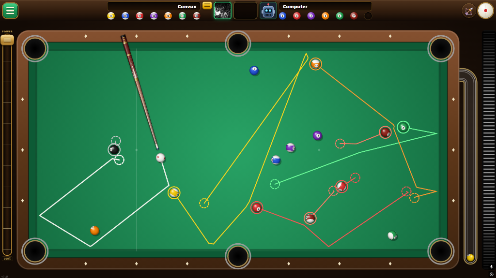

<div align="center">

# 🎱 Billiards *with* Cheats

**See every shot before you take it.**

[](LICENSE)
[](https://convux611.github.io/billiards-with-cheats)
[]()
[]()
[]()



</div>

8-ball pool that runs in your browser with zero installs. The big thing is the cheat lines — before every shot you can see the exact path every ball is going to take, so you can plan around it instead of guessing. Works online against friends, offline against a bot, or just in sandbox mode messing around.

## ✨ Features

**🎯 The cheats**
- Full trajectory preview for every ball on the table before you shoot
- Spin control (top/back/side english) via the cue ball diagram
- Adjustable power slider + mouse wheel aiming
- Undo your last shot, or full reset/rerack anytime

**🌐 Online play**
- Create or join named lobbies, with optional password protection
- Realtime 1v1 over MQTT — no dedicated server needed
- Turn timer (60s normal or 12s rapid), turn-by-turn mode, forced trick shots
- Send emoji reactions mid-match

**🤖 vs Computer**
- AI opponent at Easy, Normal, or Hard

**🎨 The feel**
- Dark billiard-hall look — walnut wood, brass trim, green felt
- 3D balls with real quaternion rotation as they roll
- Ball return tube on the side of the table — pocketed balls actually roll down it
- Sound effects for hits, cushions, and pockets

**⚙️ Settings**

| | |
|---|---|
| Cue power | 1.0× to 3.0× shot multiplier |
| Mouse wheel sensitivity | How far the aim moves per scroll notch |
| Ice table | Low friction for faster, longer shots |
| Keep cheat lines after shot | See how accurate the prediction was |

**👤 Accounts**
- Sign in with Google to get a profile (username + photo)
- Win/loss record tracked per matchup between signed-in players
- Powered by Firebase Auth + Firestore on the free tier

**📱 PWA**
- Install to home screen on Android, iOS, or desktop
- Runs fullscreen in landscape
- Cached by a service worker so it works offline

## 🕹️ Controls

**Mouse**

| | |
|---|---|
| Aim | Click and drag on the table |
| Fine-tune angle | Scroll wheel anywhere on the page |
| Set power | Hold left click + drag down behind the cue ball |
| Shoot | Release |
| Spin | Click the cue ball diagram |
| Move cue ball | Enable Move mode, then drag it |

**Touch**

| | |
|---|---|
| Aim | Touch in front of the cue ball — the stick follows your finger |
| Lock angle | Touch behind the cue ball |
| Power | Drag the slider on the left |
| Spin | Tap the cue ball diagram |

## 🛠️ Stack

The whole game — physics, renderer, UI, multiplayer client — lives in one `index.html` file. No frameworks, no build step.

| | |
|---|---|
| Canvas 2D API | Rendering, physics, cheat line drawing |
| MQTT over WebSockets | Realtime multiplayer (HiveMQ / EMQX / Mosquitto) |
| Firebase Auth | Google sign-in |
| Cloud Firestore | Player profiles and win records |
| Service Worker | Offline / PWA support |

## 🚀 Running locally

```bash
# just open it
open index.html

# or serve it (needed for PWA install)
npx serve .
```

## ⚖️ License

Proprietary — all rights reserved. See [LICENSE](LICENSE). Viewing the source doesn't give you the right to use or copy it.

<div align="center">

made with ❤️ by [Convux611](https://github.com/Convux611)

</div>
